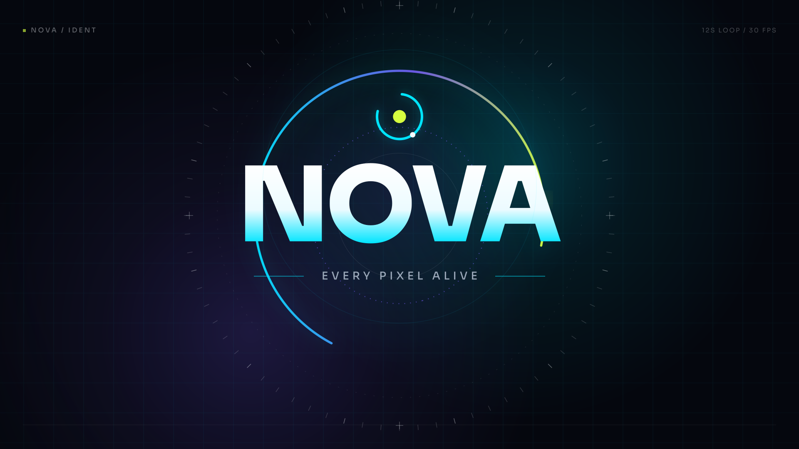

# NOVA — Every Pixel Alive

A code-rendered videotron ident and lower third, packaged for a conventional
motion-graphics workflow. The animation is authored as time-based Python/SVG,
rasterised to a straight-alpha PNG sequence, and encoded as broadcast-friendly
ProRes for import into After Effects.



## What you get

| Deliverable | Spec |
|---|---|
| `out/main_loop/main_loop_prores422hq.mov` | 12 s · 1920×1080 · 30 fps · ProRes 422 HQ · Rec.709 |
| `out/main_loop/main_loop_preview.mp4` | 12 s H.264 review file |
| `out/main_loop/png/` | 360-frame PNG sequence · straight alpha · sRGB |
| `out/lower_third/lower_third_prores4444_alpha.mov` | 6 s · 1920×1080 · 30 fps · ProRes 4444 · straight alpha |
| `out/lower_third/lower_third_preview.mp4` | 6 s H.264 review over a demo plate |
| `out/lower_third/png/` | 180-frame PNG sequence · straight alpha · sRGB |
| `ae/Import_NOVA.jsx` | Imports both sequences, builds comps, markers and a 5% safe guide |
| `out/manifest.json` | Machine-readable specs for the rendered package |
| `preview.html` | Browser playback page for the review files |

Open **`preview.html`** in a browser to watch both pieces.

## Quick start

Requirements: Python 3.10+, `rsvg-convert` (librsvg) and `ffmpeg`.

```bash
python3 src/render.py --scene all
python3 src/build_ae.py
```

On Ubuntu/Debian:

```bash
sudo apt install librsvg2-bin ffmpeg
```

On macOS:

```bash
brew install librsvg ffmpeg
```

The renderer is deterministic and uses only the Python standard library plus
those two command-line tools. The bundled Sora font is loaded through a
temporary fontconfig file; nothing is installed system-wide.

### Useful commands

```bash
# Render only one comp
python3 src/render.py --scene main
python3 src/render.py --scene lower-third

# 4K master (3840×2160). Expect ~4× render time and disk use.
python3 src/render.py --scene all --scale 2 --workers 8

# Fast preview / smoke test
python3 src/render.py --scene main --limit 30 --scale 0.5 --frames-only

# Keep per-frame SVG sources (useful for debugging or vector delivery)
python3 src/render.py --scene all --keep-svg

# Rebuild the AE importer after changing config.json
python3 src/build_ae.py
```

## After Effects

1. Open After Effects and choose **File ▸ Scripts ▸ Run Script File…**
2. Select `ae/Import_NOVA.jsx`.
3. The script creates a folder called **NOVA - Videotron Package** containing:
   - `NOVA_Main_12s` — full-frame 12 s loop
   - `NOVA_LowerThird_6s` — transparent 6 s overlay
   - PNG-sequence footage items with the correct frame rate
   - Editorial markers and a non-rendering 5% title-safe guide

Manual import works too: **File ▸ Import ▸ File**, select
`out/main_loop/png/main_loop_0000.png`, tick **PNG Sequence**, then interpret
the footage at 30 fps. For the lower third, set **Interpret Footage ▸ Alpha** to
**Straight (Unmatted)** if AE does not detect it automatically.

> The importer brings in rasterised sequences, not native AE shape layers. The
> code in `src/` is the editable source of truth: change the config or scene,
> re-render, and the AE comp updates. This is the reliable way to preserve the
> gradients, glows and variable-font typography without a Lottie round trip.

## Customise

Open `config.json`:

```json
{
  "width": 1920,
  "height": 1080,
  "fps": 30,
  "duration": 12.0,
  "safe_area": 0.05,
  "brand": { "name": "NOVA", "tagline": "EVERY PIXEL ALIVE" },
  "lower_third": {
    "name": "ALEX MORGAN",
    "role": "CREATIVE DIRECTOR",
    "kicker": "NOVA / 2026",
    "duration": 6.0
  },
  "colors": {
    "bg": "#05070e",
    "ink": "#f4f7fb",
    "muted": "#9aa7b8",
    "cyan": "#00e5ff",
    "violet": "#7c5cff",
    "lime": "#d6ff3f",
    "panel": "#070b14"
  },
  "render": { "workers": 6, "png_scale": 1 }
}
```

- **Duration** time-stretches the authored 12 s / 6 s timelines rather than
  truncating them. Markers in the AE importer scale with it.
- **FPS** changes the frame count; keep it equal to the LED processor’s output.
- **Width/height** drive the layout; the composition is responsive to portrait
  and ultra-wide frames, but always preview a test still for unusual pixel maps.
- **Colours** are used throughout the renderer; no find-and-replace needed.
- **Brand name** works best with 4–8 characters. Longer names may need a smaller
  hero/final font size in `src/scene_main.py` (search for `size = 300` and
  `250`).
- **Lower-third duration** is independent from the main loop. The default 6 s
  includes a 0.5 s transparent tail for editing.

The generated `ae/Import_NOVA.jsx` must be rebuilt after changing dimensions,
fps or duration. `render.py` and `build_ae.py` read the same config.

## Videotron / LED best practice

This package is built around the constraints of a large LED screen rather than
a desktop video player:

- **Confirm the pixel map first.** A videotron is not always 16:9. Ask the
  operator for the processor’s exact width × height and set it in `config.json`.
  A 1920×1080 master is a good review format, but the final output should match
  the wall.
- **30 fps** is the default. Match the LED processor; 60 fps is possible by
  changing `fps` and re-rendering.
- **5% safe area.** The AE importer draws a non-rendering guide at 1920/1080:
  96 px horizontal and 54 px vertical. Keep names and calls to action inside it.
- **High contrast, thick primary strokes.** The design uses a dark navy field
  with bright cyan, lime and white type. Avoid thin 1 px hairlines for critical
  information; the background grid is texture only and may disappear or moiré
  on a low-pitch wall.
- **No full-frame white.** White is restricted to type and the short transition
  flash. This reduces LED power draw and avoids blinding the viewer at night.
- **Seamless loop.** Frame 0 and the final frame both resolve to the same dark
  background. The last 0.4 s is a deliberate loop tail; keep it if the file will
  play unattended.
- **Colour discipline.** PNGs are full-range sRGB; ProRes and H.264 masters are
  Rec.709 video range. Do not add a second colour conversion in AE unless the
  screen operator asks for one.
- **Check it at distance.** Review the H.264 file at 25–50% size and from the
  intended viewing distance. If the tagline is unreadable there, increase it or
  remove it; a videotron is not a poster.
- **Audio is intentionally absent.** Add music or a sound bed in AE if the
  playback system supports it.

### Codec choice

- **ProRes 422 HQ** is the full-frame delivery master. It is robust, edits
  smoothly, and is accepted by After Effects, Premiere, DaVinci Resolve and
  most LED media servers.
- **ProRes 4444** is used for the lower third because it preserves straight
  alpha. PNG sequences are included as the most portable fallback and for AE
  projects that need frame-level control.
- **H.264** files are review copies only. They are 8-bit 4:2:0 and should not be
  used as the final videotron master.

## How the renderer works

```
config.json
    ↓
src/scene_main.py / src/scene_lower_third.py
    ↓  one SVG per frame, with cubic-bezier easing and time-based tracks
rsvg-convert
    ↓  straight-alpha PNG sequence (full-range sRGB)
ffmpeg
    ↓  ProRes 422 HQ / ProRes 4444 + H.264 review
out/  +  manifest.json
```

- `src/motionlib.py` contains the easing functions, colour helpers, SVG
  primitives and the shared brand mark. Easing names map to familiar
  cubic-bezier curves (`snap`, `aeEase`, `inOutQuint`, `outExpo`, etc.).
- `src/scene_main.py` is a 12 s, three-act loop: signal → kinetic type →
  resolved lockup.
- `src/scene_lower_third.py` is a 6 s transparent overlay with a 0.5 s tail.
- `src/render.py` renders frames in parallel, then encodes. It clears the old
  PNG folder first so a changed duration cannot leave stale frames behind.
- `src/build_ae.py` writes the ExtendScript importer from the same config.

The SVG sources are vector and resolution-independent. `--scale 2` re-renders
the same design at 3840×2160 without redesigning it.

### Why not Lottie?

Lottie is excellent for simple vector UI motion, but it has incomplete and
inconsistent support for blur/glow filters, variable-font weights and some
gradient/stroke combinations. This piece relies on those details. ProRes and
PNG sequences preserve the exact look and import natively into AE. If a Lottie
version is required, build it from the AE comp with Bodymovin and expect to
bake or simplify the glow layers.

## Project structure

```
videotron-motion/
├── config.json
├── preview.html
├── Makefile
├── README.md
├── LICENSE
├── ae/
│   └── Import_NOVA.jsx
├── assets/
│   └── fonts/
│       ├── Sora.ttf
│       └── OFL.txt
├── src/
│   ├── motionlib.py
│   ├── scene_main.py
│   ├── scene_lower_third.py
│   ├── render.py
│   └── build_ae.py
└── out/
    ├── manifest.json
    ├── main_loop/
    │   ├── png/
    │   ├── stills/
    │   ├── main_loop_prores422hq.mov
    │   └── main_loop_preview.mp4
    └── lower_third/
        ├── png/
        ├── stills/
        ├── lower_third_prores4444_alpha.mov
        └── lower_third_preview.mp4
```

## Troubleshooting

| Symptom | Fix |
|---|---|
| `rsvg-convert: command not found` | Install `librsvg2-bin` / `librsvg` and re-run. |
| Font looks like a fallback | Confirm `assets/fonts/Sora.ttf` exists. The renderer writes a temporary `fontconfig` file pointing at it. |
| AE shows a black fringe on the lower third | Interpret Footage ▸ Alpha ▸ **Straight (Unmatted)**. The ProRes 4444 and PNGs are straight alpha. |
| 4K render is slow / disk-heavy | Use `--workers 8`; expect roughly 4× the 1080p time and size. Render review files at 1080p first. |
| Colours look washed out in AE | The masters are Rec.709 video range. Set the project to Rec.709 and do not add a second LUT. |
| Need to change the edit | Change `config.json` and re-render. For precise retiming, edit in AE on top of the ProRes master. |

## Credits and licences

- Typeface: **Sora** by Jonathan Barnbrook / Google Fonts, SIL Open Font
  License 1.1. See `assets/fonts/OFL.txt`.
- Code: MIT. See `LICENSE`.
- Design and render: generated by this project. “NOVA” and “Every Pixel Alive”
  are placeholder brand content; replace them in `config.json`.
